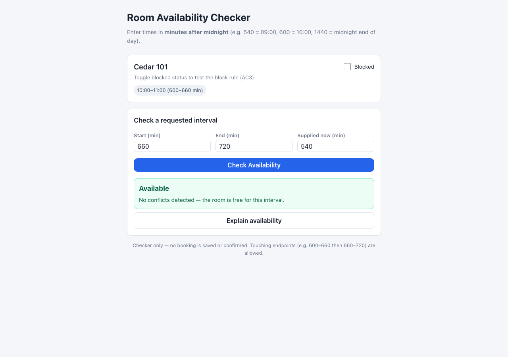
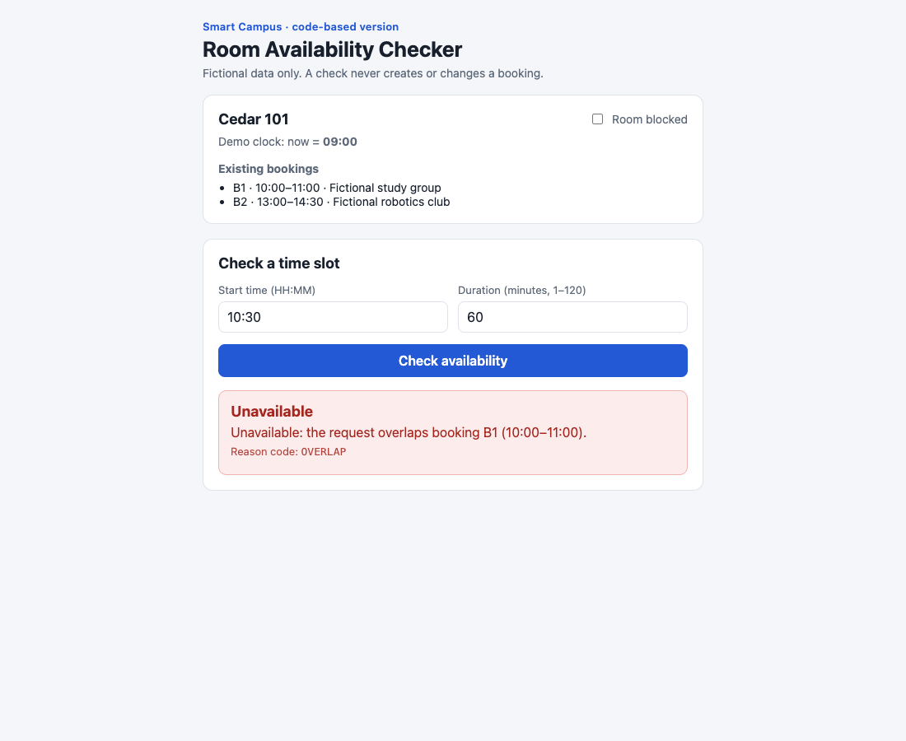
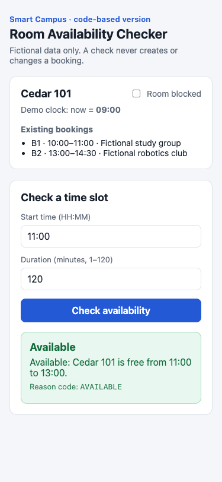
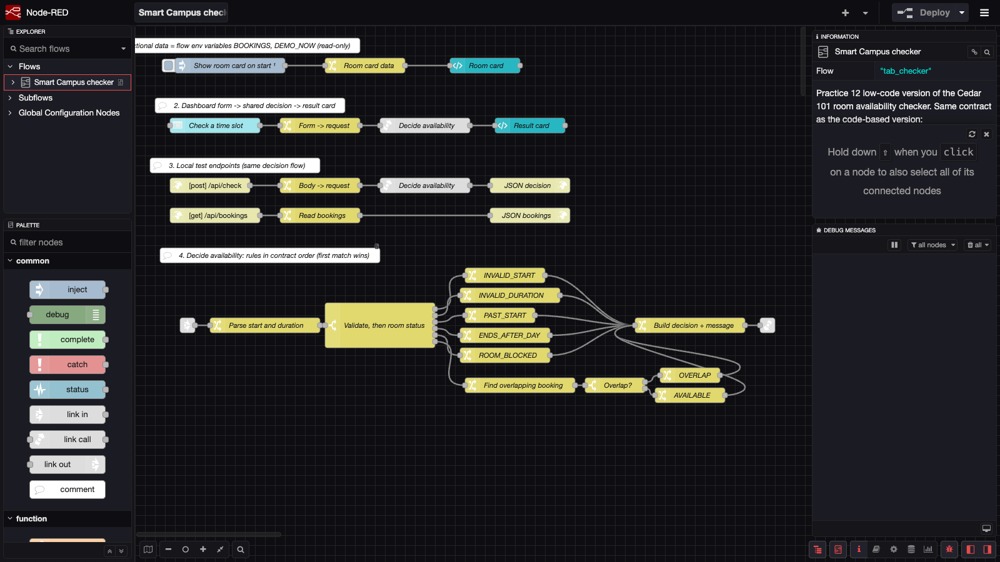
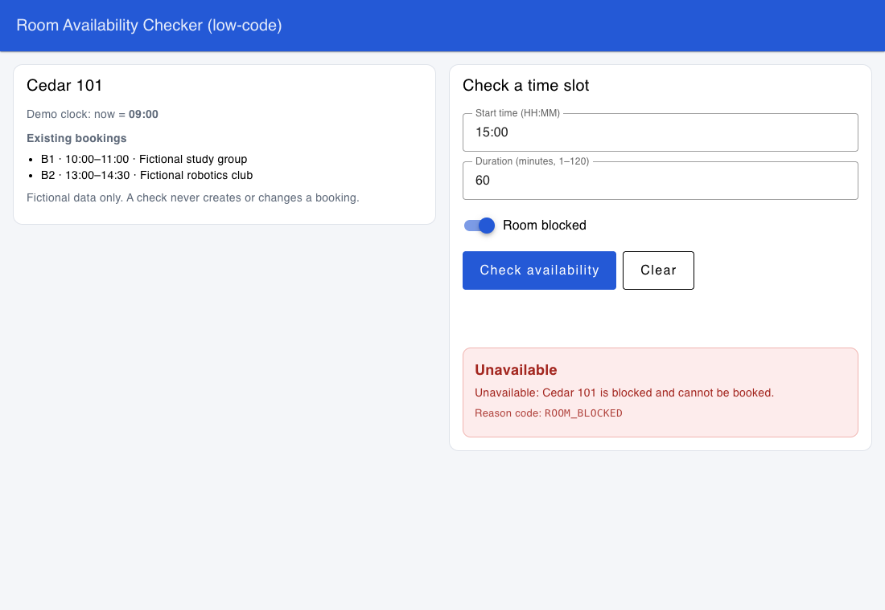
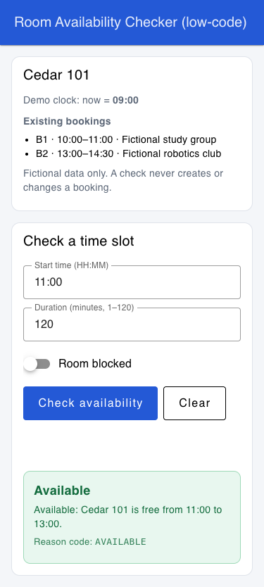

# Practice Work #12. Code-based vs low-code: Smart Campus Room Availability Checker

**Student:** Ruslan Alpenov · **Course:** Software Engineering · **Class:** Tuesday, 16:00–19:00

**AI tool:** Claude Code (Anthropic), Claude Opus 5.5 (`claude-opus-5-5`), Claude desktop app, Code tab

**Repository:** https://github.com/alpewa19/smart-campus-practice-12

**Low-code platform:** Node-RED 5.0.9 with FlowFuse Dashboard 2.0 (`@flowfuse/node-red-dashboard` 1.36.0). Free and open source, self-hosted on `127.0.0.1`. No subscription was bought.

## 1. Result at a glance

| | Code-based | Low-code |
|---|---|---|
| Shared tests T1–T8 | **8 / 8** | **8 / 8** |
| Extra security inputs S1–S4 | 4 / 4 | 4 / 4 |
| Defects found by runtime checks and review | 0 | 4 (D1–D4) |
| Fixed / unresolved | none / 0 | 3 fixed / **1 unresolved** (D3) |
| Open platform tasks | 0 | 2 (editor login, package upgrade) |
| Live demo | https://alpewa19.github.io/smart-campus-practice-12/code-based/ | local only; public hosting needs a server or an account |

**Recommendation:** use the code-based version for Smart Campus. Both versions pass the same eight tests. The low-code one needed four fixes or workarounds that the tests never caught, and it still has open items (section 9).

## 2. Task 1: Freeze the baseline

The baseline is the final Practice 11 project, `smart-campus-practice-11`, commit `81795b6`. I copied it into a separate folder and did not change it.

| Check | Result | Evidence |
|---|---|---|
| Version | commit `81795b639a1a`; `booking.js` SHA-256 `c1370933…` | `evidence/logs/01-baseline-version.log` |
| Booking data | room Cedar 101; one fictional booking 10:00–11:00 (600–660 min); "now" typed by hand, default 540 | baseline `main.js` |
| Expected behaviour | future start, duration ≤ 120 min, blocked room refused, half-open overlap, bookings never changed | baseline `AGENTS.md` |
| `npm test` | 49 passed, 0 failed | `03-baseline-test.log` |
| `npm run build` | Vite build passed | `04-baseline-build.log` |
| Lint | no lint script or linter config in the project | n/a |



The baseline takes start and end in minutes. Practice 12 asks for a start time and a duration, and returns a reason code plus a message. That is a new contract, so both new versions implement it. The booking rules stay the same as the baseline's, and I did not change them to suit either platform.

## 3. Task 2: Shared contract

Full sheet: `contract/requirements.md`. Machine-readable test inputs: `contract/test-cases.json`. Both were written before any implementation, and both test runners read the same JSON file.

**User story.** As a student, I want to choose a start time and a duration for the Cedar 101 study room, so that I can see at once whether the room is free and why.

**Inputs:**
- `start`: `HH:MM`
- `duration`: whole minutes, 1–120
- `blocked`: boolean
- fictional bookings: B1 10:00–11:00 and B2 13:00–14:30
- demo clock: `now` = 09:00

**Outputs:**
- `available`: boolean
- `reasonCode`: one of the codes below
- `message`: visible text for the student

| Reason code (rule order, first failing rule wins) | available | When |
|---|---|---|
| `INVALID_START` | false | start is not `HH:MM` |
| `INVALID_DURATION` | false | not a whole number from 1 to 120 |
| `PAST_START` | false | start is 09:00 or earlier |
| `ENDS_AFTER_DAY` | false | start + duration is after 24:00 |
| `ROOM_BLOCKED` | false | the blocked flag is on |
| `OVERLAP` | false | `start < booking.end` and `booking.start < end` |
| `AVAILABLE` | true | none of the above |

| ID | Acceptance criterion |
|---|---|
| AC1 | Start time must be in the future. |
| AC2 | Duration must be greater than zero and at most 120 minutes. |
| AC3 | Overlapping bookings are unavailable. |
| AC4 | Blocked room is unavailable. |
| AC5 | Display a clear decision without changing existing bookings. |
| AC6 | Invalid input receives understandable feedback. |

The demo clock is fixed at 09:00 so that "future" is reproducible. This is the only simulated part, and both versions use it the same way. A real deployment would read the clock.

## 4. Task 3: Code-based implementation

The code-based version is plain HTML, CSS and JavaScript modules. It has no framework, no build step and no npm packages.

| Layer | File | Lines |
|---|---|---|
| Data (frozen) | `code-based/src/data.js` | 14 |
| Validation | `code-based/src/validation.js` | 35 |
| Availability calculation | `code-based/src/availability.js` | 30 |
| Messages | `code-based/src/messages.js` | 18 |
| UI display | `code-based/src/ui.js`, `index.html`, `style.css` | 35 + 50 + 30 |
| Tests | `code-based/tests/contract.test.js`, `units.test.js` | 19 tests |

```js
// availability.js — pure; never mutates the room or the bookings
export function findOverlap(start, end, bookings) {
  return bookings.find((b) => start < b.end && b.start < end) ?? null
}

export function checkAvailability({ start, end }, room, bookings) {
  if (room.blocked) return { available: false, reasonCode: 'ROOM_BLOCKED' }
  const booking = findOverlap(start, end, bookings)
  if (booking) return { available: false, reasonCode: 'OVERLAP', booking }
  return { available: true, reasonCode: 'AVAILABLE' }
}
```

The tests came first and failed before `src/` existed (`06-code-red.log`). After the code was added they passed 19/19 (`07-code-green.log`).

The UI writes only through `textContent`, and editing any input hides the previous decision. At 375 px the fields stack and nothing scrolls sideways.

| Desktop, T2 overlap | Mobile 375 px, T7 adjacent interval |
|---|---|
|  |  |

## 5. Task 4: Low-code implementation

Node-RED is a visual flow editor, and Dashboard 2.0 adds the UI widgets. The whole app is one flow in `low-code/flows.json`, with 32 nodes.

| Node type | Count | Role |
|---|---|---|
| `ui-form` | 1 | start time, duration, "Room blocked" switch |
| `ui-template` | 2 | room card, result card (Vue text interpolation, no `v-html`) |
| `switch` | 2 | rule order as six outputs, first match wins; overlap yes/no |
| `change` | 14 | parse input, set one reason code per branch, build message, room card data, read bookings |
| `link call`, `link in`, `link out` | 4 | one shared decision sub-flow, used by the form and by the test endpoint |
| `http in`, `http response` | 4 | local test endpoints `POST /api/check`, `GET /api/bookings` |
| `inject`, `comment` | 5 | show the room card on start, section labels |
| `function` (custom JavaScript) | **0** | n/a |

The fictional bookings and the demo clock are flow **environment variables** (`BOOKINGS`, `DEMO_NOW`). They exist before the first request, and no node can change them at runtime (fix D4).



I used expressions and scripts only where no widget setting could do the job:
- 14 short JSONata expressions. Ten carry the rules: parse `HH:MM`, parse duration, end time, five switch conditions, overlap search, message builder. Four only copy data between nodes (form or request body to `req`, room card data, bookings for the test endpoint);
- one 3-line Vue method in the room card that formats minutes as `HH:MM`.

**Incomplete or simulated (clearly labelled):**

- **D3, unresolved: stale result.** The Dashboard 2.0 form sends nothing while the user types. After a check, editing a field leaves the old decision on screen until the next submit (`27-final-stale-check.log`, `stale-result-after-edit.png`). The code-based version hides it on any edit.
- **No public live demo.** Publishing needs a running Node-RED server, either a FlowFuse Cloud account or a VM. The flow is exported as `flows.json` and runs locally.
- **Flow written as JSON by the AI assistant.** It was not built by dragging nodes. I loaded it into the visual editor, checked it node by node and deployed it. So the low-code effort in section 7 is lower than a hand-built flow would need.
- **Test endpoints.** `/api/check` and `/api/bookings` exist so that the same test runner can drive both versions. They are not part of the user-facing app.

| Desktop, T3 blocked | Mobile 375 px, T7 adjacent interval |
|---|---|
|  |  |

## 6. Task 5: Identical tests

Both runners read `contract/test-cases.json`. The code-based UI and the low-code dashboard ran in headless Chrome 158. The low-code flow was also called through `POST /api/check`. A script compared every message string between the two versions, and all are identical.

Final run after all fixes:
- `27-final-code-unit.log`, `27-final-code-ui.json`
- `27-final-lowcode-api.json`, `27-final-lowcode-ui.json`

| ID | Input (start, duration, blocked) | Expected | Code-based observed | Low-code observed |
|---|---|---|---|---|
| T1 | 15:00, 60, off | `AVAILABLE` | Available: Cedar 101 is free from 15:00 to 16:00. (pass) | same text (pass) |
| T2 | 10:30, 60, off | `OVERLAP` | Unavailable: the request overlaps booking B1 (10:00–11:00). (pass) | same text (pass) |
| T3 | 15:00, 60, **on** | `ROOM_BLOCKED` | Unavailable: Cedar 101 is blocked and cannot be booked. (pass) | same text (pass) |
| T4 | 15:00, **0**, off | `INVALID_DURATION` | Duration must be a whole number of minutes from 1 to 120. (pass) | same text (pass) |
| T5 | 15:00, **121**, off | `INVALID_DURATION` | same message (pass) | same text (pass) |
| T6 | **08:00**, 30, off | `PAST_START` | Start time must be later than the current time (09:00). (pass) | same text (pass) |
| T7 | 11:00, 120, off | `AVAILABLE` (touches B1 end and B2 start) | Available: Cedar 101 is free from 11:00 to 13:00. (pass) | same text (pass) |
| T8 | after T1–T7 | bookings unchanged | 2 bookings, list identical, arrays frozen (pass) | `GET /api/bookings` and dashboard list identical (pass) |
| **Total** | | | **8 / 8** | **8 / 8** |

The extra security inputs gave the same results in both versions, 4/4 each:
- S1 `` → `INVALID_START`; no image element, no dialog;
- S2 `60.5` → `INVALID_DURATION`;
- S3 23:30 + 60 → `ENDS_AFTER_DAY`;
- S4 empty start → `INVALID_START`.

The low-code UI runner sends a sentinel request with a different reason code before each case and waits for it, so a result left over from the previous case cannot be counted again (R8). Screenshots of every case are in `evidence/screenshots/code/` and `evidence/screenshots/lowcode/`.

## 7. Task 6: Engineering effort

**Measured.** The times come from `evidence/logs/timing.csv` and from file timestamps (`26-file-timestamps.log`). They are the wall-clock times of an AI-assisted session: the assistant wrote the code and ran the checks, and I reviewed the results. Coding by hand would take far longer, so the ratio between the two tracks is the useful number.

| Phase | Code-based | Low-code |
|---|---|---|
| Setup | 0.1 min (no install) | 1.6 min (pick versions at least two weeks old, install 373 packages, settings, learn widget formats) |
| Implementation | 1.1 min (tests first, 4 modules, UI) | 0.9 min (flow + 2 templates) |
| Testing | 0.5 min | 1.5 min (API, UI, two-client check) |
| Debugging / repair | 0 min | 4.6 min: D1 0.7, D2 0.3, a failed portable D2 fix and revert 3.0, D4 0.6 |
| **Build and repair total** | **≈ 1.7 min** | **≈ 8.6 min** |
| Acceptance tests passed | 8 / 8 | 8 / 8 |
| Unresolved defects | 0 | 1 (D3) |

| Process | Code-based | Low-code |
|---|---|---|
| Review of a change | `git diff` of small `.js` files, plus `npm test` | The editor shows the nodes, but the real change is a JSON diff of `flows.json`. JSONata sits on one long line, and node positions add noise (`34-lowcode-flows-generated-to-final.diff`). |
| Export | The source is the export and runs on any static host. | `flows.json` + `package.json`; needs a compatible Node-RED runtime. |
| Version control and tests | Plain files in git; 19 unit tests run without a browser. | `flows.json` in git (`flowFilePretty`). Tests need a running Node-RED: HTTP or browser only. |

**Personal impressions (not measured).** The six-output switch reads like the contract table, so the visual flow is easy to show to a non-programmer. Most of the low-code time went on platform behaviour: widgets broadcasting to all clients, start-up order, how the server is started. It did not go on the booking rules. In the code version I could predict every behaviour by reading the code.

## 8. Task 7: Security review

### Checklist

| Check | Code-based | Low-code |
|---|---|---|
| Input validation (injection) | Strict `HH:MM` regex, digits-only duration, checks before any lookup (pass) | Same rules in JSONata. Arrays, objects, `1e2`, `__proto__` and a 200 kB field are all rejected or ignored (`20-lowcode-dast-probes.log`) (pass) |
| Output handling (XSS) | `textContent` only; CSP `script-src 'self'`; no `innerHTML` or `eval` (pass) | Vue `{{ }}` escapes; no `v-html`; no function nodes (pass) |
| User input echoed back | Never; messages are fixed text | Never |
| Error handling | No server | D2 **fixed**: stack trace with file paths on malformed JSON |
| Isolation between users | Each browser computes its own result | D1 **fixed**: results were broadcast to every open dashboard |
| Start-up behaviour | Not applicable | D4 **fixed**: wrong `AVAILABLE` answers while data was loading |
| Permissions, admin access | No admin surface | **Open**: editor and admin API without login (`GET /flows` → 200, `/auth/login` → `{}`). Bound to `127.0.0.1` only. |
| Public sharing | Public static page with fictional data only | Not published |
| Secrets | None (`24-sca-secrets-sinks.log`) | None; `credentialSecret: false` because no node has credentials |
| Connectors | None | None; palette installs from the editor disabled |
| Booking data integrity | Frozen arrays; tests check this | Env variables, no write endpoint (`POST /api/bookings` → 404); but an unauthenticated editor user could redeploy |
| SCA (dependencies) | **0 packages** | 517 packages; `npm audit`: 43 advisories, 6 high (`body-parser`, `multer`, `undici`); fixed in Node-RED 5.0.10 |
| Platform update duty | Browser only | The team owns Node-RED, Dashboard and Node.js updates. 5.0.10 is one week old and not adopted yet (two-week cool-down). **Open.** |
| DAST (safe manual runtime checks) | S1–S4 in the UI; stale-result check | S1–S4, malformed JSON, wrong types, `__proto__`, 200 kB field, two-client leak, requests during start-up |

All runtime probes targeted my own local instances on `127.0.0.1`. No third-party service was scanned.

### Defects found

**D1: results shared between users (low-code, high, fixed).**
- *Found:* client A checked 16:45 for 15 minutes, and client B, who typed nothing, saw "Available … 16:45 to 17:00". New visitors also got the last user's result when the page loaded (`15-dast-shared-result-before.log`).
- *Fix:* the dashboard attaches the client id to every message (`includeClientData`, `acceptsClientConfig`), and the result card no longer stores its last message (`16-lowcode-fix1.diff`).
- *Retest:* B sees nothing (`27-final-lowcode-dast-shared.log`).

**D2: stack trace disclosure (low-code, medium, fixed with a limit).**
- *Found:* a malformed JSON body returned an HTML page with a full stack trace and absolute file paths.
- *Fix:* `NODE_ENV=production` in `npm start` (`21-lowcode-fix2.diff`).
- *Retest:* the response is now `Bad Request` (`27-final-lowcode-malformed.log`).
- *Limit:* I tried to move the setting into `settings.js` so that it would also work when Node-RED is started directly or on Windows. It did not work, because Node-RED creates its web server before it reads settings (`32-verify-r4-and-direct-start.log`). I reverted it (`29-lowcode-fix2b-REVERTED.diff`). Starting Node-RED any other way than `npm start` on macOS/Linux still leaks the trace.

**D3: stale result after editing (low-code, low, unresolved).** See section 5. Fixing it means replacing the form widget with separate inputs that emit change events.

**D4: wrong answers during start-up (low-code, high, fixed).**
- *Found:* the AI reviewer suggested this (R4); I reproduced it. In the first moments after start, a request for 10:30–11:30, which overlaps B1, got `AVAILABLE` 177 times in a row before the correct `OVERLAP` (`32-verify-r4-and-direct-start.log`). The cause: the bookings were loaded into flow context 0.2 s after start-up.
- *Fix:* bookings and the clock are now flow environment variables.
- *Retest:* from the first answer onward, 300 of 300 were `OVERLAP` (`33-verify-r4-after-fix.log`).

**Observation: blocked flag type.** The two versions handle a non-boolean `blocked` value differently:
- Low-code treats only boolean `true` as blocked, so `"true"` as a string gives `AVAILABLE` (fails open).
- Code-based treats any truthy value as blocked, so `'false'` as a string gives `ROOM_BLOCKED` (fails closed, `28-verify-ai-r3-r4.log`).

The contract says boolean, and both UIs always send a boolean, so this is not a user-facing defect. It does show that each platform needs its own type checks.

## 9. Open items before any shared use of the low-code app

1. Add `adminAuth` to the Node-RED editor, or run the editor separately from the dashboard.
2. Upgrade to Node-RED 5.0.10 or later after the cool-down, then rerun `npm audit`, T1–T8 and the DAST probes.
3. Fix D3: replace the form with inputs that clear the result.
4. Make D2 independent of the start command: set `NODE_ENV` in the service manager or container, or add an error-handling middleware.
5. Remove the test endpoints or put them behind authentication.

## 10. AI-assisted review and how I verified it

A read-only Claude Code reviewer (the Explore agent, with no write tools) got the "comparison and review" prompt from the slides, plus the contract, both implementations and the evidence logs. The prompt is in `evidence/ai/01-review-prompt.md` and its unedited answer in `02-review-output.md`. I checked every finding against a command or the code before accepting it.

| ID | Reviewer's claim | My verification | Verdict |
|---|---|---|---|
| R1 | Editor and admin API have no login | `/auth/login` → `{}`, `GET /flows` → 200 (`35-…log`) | **Confirmed**, open item |
| R2 | 6 high advisories; fix in 5.0.10 not applied | `11-lowcode-npm-audit.json`; release dated one week before the practice | **Confirmed**, deliberately deferred |
| R3 | `blocked` type handled differently | String `"true"` → AVAILABLE in low-code; `'false'` → ROOM_BLOCKED in code-based (`28-…log`) | **Confirmed** as an observation; the UIs send booleans |
| R4 | Start-up race may answer AVAILABLE | My first probe hit an old server and showed nothing. Rerun on a fresh server: 177 wrong AVAILABLE answers | **Confirmed**, fixed (D4) |
| R5 | Bookings read-only only by convention | `flow.bookings` was writable context | **Confirmed**, mitigated: env variables. Redeploy through the editor is still possible (R1) |
| R6 | D1 fix depends on easy-to-miss settings | Fix diff is three flags; I re-run the two-client test in the final regression | **Confirmed**, check kept in the regression |
| R7 | D2 fix depends on the start command | `settings.js` attempt failed (`32-…log`) | **Confirmed**, open item |
| R8 | Low-code UI test could count a stale result | True for T4→T5. Runner now uses a sentinel before each case; still 8/8 | **Confirmed**, test fixed |
| R9 | Message builder's last `else` returns the ENDS_AFTER_DAY text for unknown codes | Read in `flows.json` (`35-…log`); code-based throws and tests this | **Confirmed**, low risk while codes are fixed |
| R10 | Local static server has no headers and lists folders | `curl -I` shows no security headers; `/tests/` is listed (`35-…log`) | **Confirmed** for the local server only; tests are public in the repo anyway |

**Unsupported or overstated by the reviewer:**
- The reviewer read the timing log before the security phase, so its "1m41s vs 3m59s" left out repair time. Section 7 includes it.
- "No dependencies means no supply-chain risk" was its own caveat, not my claim. I agree the browser and the Python static server are still trusted components.

**What I would not have accepted without evidence:** R4. It looked like a hypothesis about timing, and my first probe seemed to disprove it. The probe was wrong: Node-RED renames its process, so `pkill` did not stop the old server, and the "restart" hit the previous instance. A clean rerun proved the reviewer right. I marked the invalid logs `INVALID` instead of deleting them.

## 11. Comparison matrix

| Criterion | Code-based | Low-code |
|---|---|---|
| Functional tests | **8 / 8** | **8 / 8** |
| Build and repair time | **≈ 1.7 min** (AI-assisted, measured) | **≈ 8.6 min** (AI-assisted, measured; 4.6 min of it repair) |
| Customization | Full control of layout, behaviour and validation; hiding a stale result took 3 lines | Widget settings plus JSONata and Vue templates. The form cannot react to typing (D3). Per-user results and start-up order needed platform-specific settings. |
| Security controls | No server, no dependencies, CSP, text-only output; 0 open findings | Safe enough for a local demo only after D1, D2 and D4. Open: editor without login, 6 high advisories until upgrade. Larger attack surface: editor, admin API, websockets, 517 packages. |
| Versioning / portability | Plain files in git; any static host or a local file; 19 unit tests without a runtime | `flows.json` in git, but diffs are hard to review. Needs a Node-RED runtime. Portable between Node-RED installs, not to other platforms. |
| Ongoing cost | $0 on free static hosting; only my own code to maintain | $0 licence, but needs an always-on server or a FlowFuse plan for public use, plus regular platform and package updates |

## 12. Recommendation

Use the **code-based** version for Smart Campus. Correctness does not separate the two, since both pass 8/8. The evidence that does:

- The low-code version had four defects that the functional tests did not catch: shared results, stack traces, wrong answers at start-up, and a stale result. One is still open.
- It needs two platform tasks before anyone else uses it: an editor login and a package upgrade.
- It adds 517 packages and 6 high advisories to a feature that needs none.
- It cannot be published for free without a server.

Low-code is still useful as a quick way to show the rule flow to non-programmers. If the team wants that, close the open items in section 9 first.

## 13. AI-use reflection

**What AI generated.** Claude Code (Claude Opus 5.5) generated the test-case JSON from my contract, the code-based modules and tests, the Node-RED flow as JSON, the headless-browser test scripts, and a read-only comparison review based on the slide prompt.

**What I verified.** Every result comes from a command whose log is in `evidence/logs`:
- red-then-green unit runs and UI runs for both versions;
- the identical-message comparison;
- the two-client leak test, before and after;
- the malformed-JSON probe, before and after;
- the start-up race, before and after;
- `npm audit` and the secrets grep.

**What I changed.**
- Scoped dashboard results to the user who asked (D1).
- Hid stack traces (D2), and reverted a version of that fix that did not work.
- Moved the fictional data into read-only environment variables (D4).
- Hardened the low-code UI test (R8).
- Pinned package versions at least two weeks old.
- Labelled every simulated or unfinished part.

**What I learned.** Both versions passed every functional test on the first run. The real differences showed up only in multi-user, start-up and error-handling checks. One of my own checks was wrong too, until the AI reviewer's claim made me look again.
